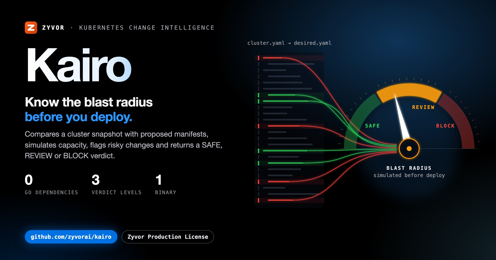
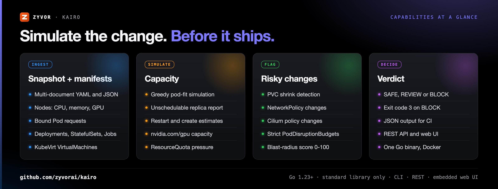
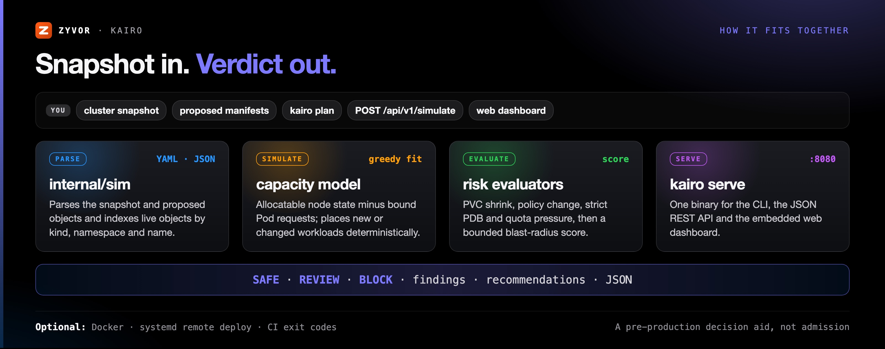

<div align="center">

# Kairo

[](https://github.com/zyvorai/kairo/actions/workflows/ci.yml)
[](LICENSE)
[](go.mod)

[](https://zyvor.dev/schedule?utm_source=github&utm_medium=kairo&utm_campaign=readme_hero)
[](https://zyvor.dev/poc?utm_source=github&utm_medium=kairo&utm_campaign=readme_hero)
[](#quickstart)



### Know the blast radius before you deploy.

**Kubernetes change intelligence.** Kairo compares a cluster snapshot with proposed manifests, runs deterministic capacity simulation, identifies high-risk object changes, and produces a machine-readable SAFE, REVIEW or BLOCK verdict. One dependency-light Go binary serves the CLI, REST API, and embedded web dashboard.

**SAFE · REVIEW · BLOCK** · **Deterministic capacity simulation** · **0 Go dependencies** · **1 binary: CLI, API, web** · **Zyvor Production Licence v2.0**

📖 **[Architecture notes](docs/ARCHITECTURE.md)** — parser, simulation engine, and security model.

</div>

[Client overview (PDF)](docs/Kairo-Client-Overview.pdf)

---

## Why Kairo

| When this happens… | Kairo gives you… |
|---|---|
| A rollout leaves replicas Pending because the cluster was already full | Greedy pod-fit simulation against allocatable CPU, memory and `nvidia.com/gpu`, with unschedulable replicas reported before deploy |
| A one-line change restarts more workloads than anyone expected | Restart and create estimates for every changed manifest |
| Someone shrinks a PVC or tightens a NetworkPolicy in a big diff | PVC shrink detection and NetworkPolicy, CiliumNetworkPolicy and CiliumClusterwideNetworkPolicy change warnings |
| A strict PodDisruptionBudget blocks the drain mid-change | Strict PDB detection and a drain simulation |
| The API server rejects pods over a namespace quota or outside its LimitRange | `ADMISSION_QUOTA_*` and `ADMISSION_LIMITRANGE_*` findings before apply |
| The cluster is half empty and nobody knows which nodes could go | `kairo consolidate`: which nodes can be emptied, and what that frees (with optional price inputs for a monthly estimate) |
| Reviewers read YAML diffs and guess the risk | A blast-radius score, a LOW/MEDIUM/HIGH level and a SAFE/REVIEW/BLOCK verdict |
| CI has no way to stop a risky change | `kairo plan` exits `3` on BLOCK, with `-json` output for pipelines |



<a id="what-works-in-this-release"></a>

### What works in this release

- Multi-document Kubernetes YAML and JSON ingestion.
- Node allocatable CPU, memory and `nvidia.com/gpu` capacity modelling.
- Existing bound Pod request accounting.
- Deployment, StatefulSet, DaemonSet, Pod, Job and KubeVirt `VirtualMachine` request modelling.
- Greedy pod-fit simulation with unschedulable-replica reporting.
- Node cordon (`spec.unschedulable`) and `NoSchedule`/`NoExecute` taint awareness (excluded unless the pod tolerates them; DaemonSets tolerate cordons automatically and run one pod per eligible node) and `nodeSelector` matching against node labels.
- HorizontalPodAutoscaler awareness: a changed Deployment/StatefulSet with an HPA uses `maxReplicas` as the capacity worst case. `HPA_MAX_UNSCHEDULABLE` is reported when the maximum cannot schedule, `HPA_MIN_EXCEEDS_REPLICAS` when `minReplicas` is above the declared replicas, and `HPA_INVALID_BOUNDS` when min exceeds max. These raise the verdict to at least REVIEW.
- Risks are returned sorted by severity (critical first), then code, then resource, so output is stable.
- Workload restart/create estimates for changed manifests.
- PVC shrink detection.
- NetworkPolicy, CiliumNetworkPolicy and CiliumClusterwideNetworkPolicy change warnings.
- Strict PodDisruptionBudget detection.
- Security findings introduced by a change: privileged containers, `hostNetwork`, `hostPID`, `hostPath` volumes, privilege escalation (not re-flagged when already live).
- Exposure and access control: new `LoadBalancer`/`NodePort` Services, Ingress changes, wildcard Roles/ClusterRoles, `cluster-admin` bindings.
- `kairo plan -format text|json|markdown` (markdown is ready to post as a PR comment) and `-fail-on BLOCK|REVIEW|never` for CI gating.
- YAML flow collections with plain scalars (`{name: web, ports: [80, 443]}`) are parsed, not just JSON-style ones.
- ResourceQuota and LimitRange admission checks (see below), node drain, consolidation and optional cost estimates.
- Blast-radius score, LOW/MEDIUM/HIGH level and SAFE/REVIEW/BLOCK verdict.
- CLI, JSON REST API and polished zero-build web UI.
- Docker image, health endpoint, GitHub Actions CI and unit/integration tests.
- Remote systemd deploy + smoke (`scripts/deploy-remote.sh`).

---

## How it fits together



```text
              Git / Helm / GitOps / CI
                       |
                       v
+--------------------------------------------------+
|                 Kairo simulation                 |
|                                                  |
|  parse -> index live objects -> model capacity   |
|       -> evaluate desired objects -> score       |
|                                                  |
|  scheduling  PVC  PDB  quota  policy  KubeVirt  |
+---------------------+----------------------------+
                      |
            +---------+---------+
            |         |         |
           CLI       REST      Web
```

Simulation lifecycle, and why the engine does not pretend to be kube-scheduler: [docs/ARCHITECTURE.md](docs/ARCHITECTURE.md).

---

<a id="run-it"></a>

## Quickstart

Requires Go 1.26+.

```bash
go run ./cmd/kairo serve
```

Open `http://localhost:8080`. The dashboard automatically loads and simulates the included production-risk demo.

Build a binary:

```bash
make build
./bin/kairo serve
```

## CLI

```bash
./bin/kairo plan \
  -cluster examples/cluster.yaml \
  -f examples/desired.yaml
```

Exit codes:

- `0`: SAFE or REVIEW
- `3`: BLOCK
- `1`: parsing/runtime error
- `2`: invalid CLI usage

Show what changed per object (replicas, images, resource requests/limits):

```bash
./bin/kairo plan -cluster examples/cluster.yaml -f examples/desired.yaml -explain
```

With `-json`, `-explain` adds a `changes[]` array (`kind`, `namespace`, `name`, `action` of created/changed/deleted, and `fields[]` of `field`/`old`/`new`). The REST API always includes `changes`.

Machine-readable output:

```bash
./bin/kairo plan -cluster examples/cluster.yaml -f examples/desired.yaml -json
```

### Rolling-update surge check

When a Deployment's pod template changes, `plan` also simulates the rollout peak: `maxSurge` extra pods (default 25%, rounded up) are placed on top of the steady-state placement. If they cannot be scheduled the finding `ROLLOUT_SURGE_UNSCHEDULABLE` is raised: `high` when `maxUnavailable` is 0 (the rollout can never finish), `medium` otherwise (it proceeds with reduced capacity). Verdict is at least `REVIEW`. `Recreate` strategy, replica-only changes and new Deployments are not rollouts and are not flagged.

### Removed / deprecated API versions

`plan` checks every desired object's `apiVersion` against a curated removal table (extensions/v1beta1, batch/v1beta1, policy/v1beta1, autoscaling/v2beta*, networking.k8s.io/v1beta1 and more). Use `-target-version` to choose the Kubernetes version the manifests must be valid on (default: newest known, 1.33):

```bash
./bin/kairo plan -cluster examples/cluster.yaml -f desired.yaml -target-version 1.25
```

`API_REMOVED` (critical, verdict `BLOCK`) means the API server rejects the manifest at that version; `API_DEPRECATED` (medium) means it still works but is scheduled for removal. The result carries `targetVersion`, `apiRemoved` and `apiDeprecated`.

### Node drain / upgrade simulation

```bash
./bin/kairo drain -cluster examples/drain-cluster.yaml -node worker-a        # one node
./bin/kairo drain -cluster snapshot.yaml -node pool-1,pool-2 -format json    # an upgrade wave
```

Simulates `kubectl drain`: DaemonSet and static pods are ignored; pods without a controller are reported as lost (`DRAIN_UNMANAGED_POD`); other pods are evicted and rescheduled (largest first) onto the nodes that remain, honouring requests, `nodeSelector`, taints and cordons (`DRAIN_UNSCHEDULABLE`). A PodDisruptionBudget that allows no disruption blocks the drain (`DRAIN_PDB_BLOCKED`); one that allows fewer than needed serializes it (`DRAIN_PDB_SERIALIZED`). Also flagged: workloads whose every replica is on the drained nodes (`DRAIN_ALL_REPLICAS`) and emptyDir data loss (`DRAIN_LOCAL_DATA`). Verdicts are `SAFE`, `REVIEW` or `BLOCK`; `-fail-on` works as in `plan` (exit 3).

### Consolidation / right-sizing simulation

```bash
./bin/kairo consolidate -cluster examples/consolidate-cluster.yaml
./bin/kairo consolidate -cluster snapshot.yaml -format json -node-hour-price 0.12 -currency USD
```

Bin-packs the existing controller-managed pods onto fewer nodes with the same placement rules as `drain` (requests, `nodeSelector`, taints, cordons, PodDisruptionBudgets) and reports which nodes could be emptied, the pods that would move, the node count before and after, the CPU, memory and GPU capacity reclaimed, and requested utilisation before and after. A node stays when it holds an unmanaged pod, a pod annotated `karpenter.sh/do-not-disrupt: "true"` or `cluster-autoscaler.kubernetes.io/safe-to-evict: "false"`, a pod that fits nowhere else, or when a PDB has no budget left; the last node is always kept. DaemonSet and static pods are ignored (they vanish with the node).

The plan is a deterministic greedy heuristic (emptiest node first, best-fit decreasing): achievable, not guaranteed minimal. Every result carries a `notModelled` list: pod/node affinity, topology spread, PersistentVolume topology and attach limits, observed usage (only requests are used, so this is not per-pod request right-sizing), max-pods and reservations, priority/preemption, node pools and autoscaler policies, and PDBs evolving over time.

### Cost estimates

`plan` and `consolidate` accept optional prices: `-node-hour-price`, `-gib-hour-price` and a `-currency` label (API: `prices: {nodeHourPrice, gibHourPrice, currency}`). They produce a `cost` object with a monthly delta over a fixed 730-hour month, negative for savings. For `consolidate` the node part is removed nodes times the node-hour price and the memory part is reclaimed GiB times the GiB-hour price. For `plan` the node part is the larger of the CPU and memory deltas as a proportional share of an average snapshot node, and the memory part prices the requested-memory delta. Use the GiB price only when memory is billed separately from the node, otherwise memory is counted twice. It is always labelled an estimate from your prices; Kairo makes no cloud pricing API calls, and with no prices there is no `cost` field.

### Quota and LimitRange admission checks

For each changed workload (and PVC), `plan` evaluates the ResourceQuota and LimitRange objects of its namespace, from the snapshot with the proposed manifests laid over them:

| Code | Meaning |
|---|---|
| `ADMISSION_LIMITRANGE_MAX` | a container or pod limit/request is above the LimitRange `max` (or has no limit while a `max` is set and no `default` supplies one); a PVC is above the claim `max` |
| `ADMISSION_LIMITRANGE_MIN` | a request or limit is below the `min` |
| `ADMISSION_LIMITRANGE_RATIO` | limit/request exceeds `maxLimitRequestRatio` |
| `ADMISSION_QUOTA_EXCEEDED` | projected namespace usage (`requests.cpu/memory`, `limits.cpu/memory`, `pods`, `requests.nvidia.com/gpu`) exceeds the quota and the change increased it |
| `ADMISSION_QUOTA_NO_REQUESTS` | a quota constrains requests/limits that the pods do not set, even after LimitRange defaults |

Defaults are applied the way the API server does: a missing request takes the explicit limit, then the LimitRange `defaultRequest`/`default`. These findings BLOCK (the API server rejects the pods) and replace the older `QUOTA_PRESSURE` check, which compared cluster-wide totals with a single namespace quota. Not modelled: scoped quotas (skipped), `count/*` object quotas, ephemeral storage, surge pods counting against quota.

## REST API

```bash
curl -s http://localhost:8080/healthz
curl -s http://localhost:8080/readyz
curl -s http://localhost:8080/api/v1/version
```

Request bodies are limited to 4 MiB (413 beyond that); the server enforces read-header (5s), read (10s), write (20s) and idle (60s) timeouts.

```bash
curl -s http://localhost:8080/api/v1/simulate \
  -H 'content-type: application/json' \
  -d @request.json
```

Request shape:

```json
{
  "clusterYaml": "apiVersion: v1\nkind: Node\n...",
  "desiredYaml": "apiVersion: apps/v1\nkind: Deployment\n...",
  "targetVersion": "1.29"
}
```

`targetVersion` and `prices` are optional. `POST /api/v1/consolidate` takes `{"clusterYaml": "...", "prices": {...}}` and returns the consolidation plan. `POST /api/v1/drain` takes `{"clusterYaml": "...", "nodes": ["worker-a"]}` and returns the drain result (`verdict`, `pods[]`, `risks[]`, counters). Invalid input returns 400, unknown node, bad target version or invalid prices 422. The full contract is in [`docs/openapi.yaml`](docs/openapi.yaml); a test fails when a registered route or a response field is missing from it.

### Web console

Beyond the plan simulator, the embedded console (`kairo serve`) has views for node drain, consolidation, rollout surge, API removal (with a target-version selector) and the `plan -explain` change list, plus optional price inputs. They call the same REST endpoints on the snapshot and proposal in the editors.

## Get a real cluster snapshot

For an initial snapshot, capture resources relevant to scheduling and change impact. Adapt the list to your environment and CRDs:

```bash
kubectl get nodes,pods,deployments,statefulsets,daemonsets,services,pvc,pdb,resourcequota,networkpolicy -A -o yaml > snapshot.json
```

`kubectl get ... -o yaml` returns a `List`; the current dependency-light reader focuses on individual objects or JSON arrays. A production collector should normalize Lists into objects before the simulation engine.

## Docker

```bash
docker build -t kairo:dev .
docker run --rm -p 8080:8080 kairo:dev
```

## Remote deploy

Cross-compiles locally and installs Kairo as a systemd service over SSH (same pattern as Chimera/Scout):

```bash
# Explicit port (CLI flag)
./scripts/deploy-remote.sh 212.8.248.187 sus --port 19615

# Or via env
KAIRO_PORT=19615 ./scripts/deploy-remote.sh 212.8.248.187 sus

# Omit port → reuse .deploy-last PORT, else pick random 18000–28999
./scripts/deploy-remote.sh 212.8.248.187 sus

# Smoke (URL, --port, env, or .deploy-last)
KAIRO_URL=http://212.8.248.187:19615 ./scripts/smoke-remote.sh
./scripts/smoke-remote.sh --port 19615

# Remove
./scripts/deploy-remote.sh 212.8.248.187 sus --uninstall
```

## Development

```bash
make check
make test-e2e
```

Repository layout:

```text
cmd/kairo/             CLI + server entry point
internal/api/          REST API
internal/sim/          parser + deterministic simulation engine
internal/web/static/   embedded product dashboard
examples/              demo cluster + proposed manifests
docs/                  architecture and security notes
scripts/               integration smoke test
.github/workflows/     CI
```

## Architecture direction

The core is deliberately small enough to extend. Production-grade follow-on adapters can add:

- Kubernetes discovery/collector and informer snapshots.
- Native kube-scheduler framework integration.
- Admission webhook dry-run replay.
- Cilium/PacketWolf observed-flow replay.
- CSI/storage topology and snapshot checks.
- GPU/NVLink/MIG topology modelling.
- KubeVirt migration/topology checks.
- GitHub/GitLab PR checks and Argo CD/Flux gates.
- Historical twins, drift and multi-cluster simulations.

See [docs/ARCHITECTURE.md](docs/ARCHITECTURE.md).

---

## Maturity

> Kairo is a pre-production decision aid, not a replacement for Kubernetes admission, the real scheduler, policy engines or progressive delivery. The in-repo YAML reader supports the common Kubernetes manifest subset and JSON; advanced YAML anchors/tags are intentionally not supported in this dependency-free release.

The engine does not yet execute scheduler framework plugins, topology spread, affinity/anti-affinity, taints/tolerations, CSI topology, device plugins, webhooks or controller reconciliation; those are extension points ([docs/ARCHITECTURE.md](docs/ARCHITECTURE.md)).

---

## Part of the Zyvor stack

| Product | Role next to Kairo |
|---|---|
| **Kairo** | Kubernetes change intelligence: capacity simulation, risk checks, deployment verdict |
| **[Zorvia](https://github.com/zyvorai/zyvor-zorvia)** | Pairs with Kairo: Kairo models KubeVirt `VirtualMachine` requests, so VM changes get the same preflight |
| **[Janus](https://github.com/zyvorai/janus)** | Pairs with Kairo: a full GPU scheduling simulator (MIG, topology, gang jobs) where Kairo models `nvidia.com/gpu` capacity only |
| **[Haven](https://github.com/zyvorai/zyvor-haven)** | Pairs with Kairo on the same private-cloud clusters: Keycloak + HA Postgres as one identity plane |

→ [zyvor.dev](https://zyvor.dev)

---

## Support

A 30-day trial is available on request from sales@zyvor.dev (a paid evaluation Order at no charge); production and any other use needs a paid Order under the Zyvor Production Licence v2.0. If it helps you, you can donate any amount you like: <https://rzp.io/rzp/utwdYh3>. A donation is voluntary and supports development and maintenance. It is not a purchase: it buys no support, SLA, features, priority or license, and it is not tax-deductible (Zyvor AI Labs Private Limited is a company, not a charity). Support contracts are separate: [sales@zyvor.dev](mailto:sales@zyvor.dev).

## License

Kairo is source-available under the **[Zyvor Production Licence v2.0](LICENSE)** (SPDX `LicenseRef-Zyvor-Production-2.0`, also in [LICENSES/](LICENSES/LicenseRef-Zyvor-Production-2.0.txt); see [NOTICE](NOTICE)). A 30-day trial is available on request from sales@zyvor.dev (a paid evaluation Order at no charge); production and any other use needs a paid Order under the Zyvor Production Licence v2.0. Production use needs a commercial license from Zyvor AI Labs Private Limited: [zyvor.dev/buy](https://zyvor.dev/buy) · [sales@zyvor.dev](mailto:sales@zyvor.dev). A 30-day trial key is available for production evaluation.

**Price:** INR 49,999 per cluster per year incl. 18% GST in India; US$504 per cluster per year excl. tax elsewhere. Buy: [zyvor.dev/buy](https://zyvor.dev/buy). Orders of USD 5,000 or more and quotes are invoiced in USD through Skydo.

**Zyvor Enterprise** adds what production teams ask for: supported releases, deployment and upgrade guidance, priority incident triage, a named technical contact and 24x7 critical intake. Production support, SLAs, and Zyvor Enterprise products are licensed separately. Plans and terms: [docs/SUBSCRIPTION-MODEL.md](docs/SUBSCRIPTION-MODEL.md) · [Pricing](https://zyvor.dev/pricing?utm_source=github&utm_medium=kairo&utm_campaign=readme_license) · [sales@zyvor.dev](mailto:sales@zyvor.dev).

Contributions: [CONTRIBUTING.md](CONTRIBUTING.md). Report vulnerabilities privately per [SECURITY.md](SECURITY.md).

---

<div align="center">

### Put a verdict on every change before it ships

[](https://zyvor.dev/schedule?utm_source=github&utm_medium=kairo&utm_campaign=readme_footer)
[](https://zyvor.dev/poc?utm_source=github&utm_medium=kairo&utm_campaign=readme_footer)
[](https://zyvor.dev/pricing?utm_source=github&utm_medium=kairo&utm_campaign=readme_footer)
[](mailto:sales@zyvor.dev?subject=Kairo)
[](https://github.com/zyvorai/kairo)

</div>
